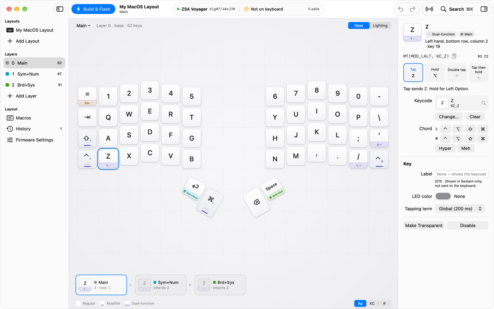

# Sextant

A native macOS app for configuring the ZSA Voyager: edit layouts on your Mac, import them from Oryx, build the firmware locally, flash it, and watch the keyboard live.

[](https://github.com/afrase/Sextant/actions/workflows/ci.yml)
[](LICENSE)




> [!NOTE]
> Sextant is an independent project. It is not affiliated with or endorsed by ZSA Technology Labs. ZSA, Voyager, Navigator, Oryx and Keymapp are trademarks of their respective owners and are used here only to describe compatibility. The repo contains no ZSA artwork.

## What it does

- **Edits layouts locally,** with undo: layers, tap/hold/double-tap actions, modifier chords, labels, per-key LED colors and tapping terms, macros, firmware settings and the Navigator trackpad or trackball.
- **Imports from Oryx** by pasting a layout link, or from the layout id the connected keyboard reports. It uses Oryx's public GraphQL read-only: no login and no changes to your Oryx account.
- **Builds QMK firmware on your Mac** with a pinned toolchain that runs in a sandbox. The first build downloads about 200 MB of build tools, each checked by size and SHA-256.
- **Flashes the keyboard over DFU,** behind strict guards (see [Safety](#safety)).
- **Shows the keyboard live:** the active layer and the keys you press, on the board. Off by default. While it's on, you can move the keyboard to a layer from the Keyboard menu, or from any app with optional global shortcuts (⌃⌥0–⌃⌥9).
- **Keeps history and exports:** saved revisions you can compare and restore, and export as layout JSON, QMK source, firmware, PNG or PDF.

## Status

- The MVP is complete and v1 is under way ([docs/progress.md](docs/progress.md), [docs/v1-plan.md](docs/v1-plan.md)). Sextant is developed with Claude Code, and those two files are its working log.
- There is no signed release yet. Build it from source.
- It has been tested on one Voyager with the STM32 bootloader. Images for the GD32 bootloader are refused. The Navigator trackball is untested.

## Requirements

- macOS 26 on Apple silicon (the firmware build tools Sextant downloads are arm64 builds).
- Xcode 26 with Swift 6.2 or later.
- A ZSA Voyager, to build for and flash. Editing works without one.

## Build and run

```sh
git clone https://github.com/afrase/Sextant.git
cd Sextant
scripts/bundle            # release build, signed ad hoc, at .build/Sextant.app
open .build/Sextant.app
```

`scripts/bundle` signs with `SEXTANT_SIGN_IDENTITY` (a Developer ID) when it is set, and takes the version from `SEXTANT_VERSION`. `scripts/check` is the quality gate: formatting, lint and layer rules, a warnings-as-errors build and the tests.

## Flashing and the live view

Build & Flash works out of the box: it builds the firmware, asks you to put the keyboard in flash mode, checks the image and writes it (see [Safety](#safety)). It asks first if the keyboard runs a different layout.

The live view (the active layer and the keys you press) starts only when you turn it on: click the live button in the toolbar, or choose Keyboard ▸ Live View. Plugging the keyboard in never starts it, because pairing writes to the keyboard.

While the live view is on, Keyboard ▸ Move Keyboard to Layer (also in the Device popover) moves the keyboard to the layer you choose. Settings › Keyboard can turn on global shortcuts that do the same from any app, ⌃⌥0–⌃⌥9 unless you record others. They're off by default, and while they're on other apps don't get those keys.

## Safety

- **The flasher writes only the application region,** `[0x08002000, 0x08042000)`, and can't express a mass erase, so the bootloader is never touched.
- **Every image is checked before the first write:** its DFU suffix (vendor id, product id and CRC) must match the connected bootloader, and its md5 must match the build. Status polling is capped, and `dfuERROR` is a failure.
- **It asks first** before replacing a keyboard that runs a different layout.
- **Generated firmware keeps the Navigator modules,** so the trackpad keeps working.
- **Builds run in a sandbox** with no network, no access to your files, and writes only to the build folder.
- **A layer move is sent only when you ask:** one choice or shortcut press moves the keyboard once, only while the live view is on, and only to a layer its layout has (just layer 0 when Sextant doesn't have that layout), since a layer past the build's layers drops the keyboard to its base layer.
- **The live view is private:** it sees key positions, never characters, keeps events in memory only, and pauses while secure input (a password field) is on.
- **Recovery:** if a flash goes wrong, the Voyager's reset button puts it in its bootloader, and you can flash again.

## Privacy

Sextant has no accounts, analytics or telemetry. It goes online only to import from Oryx and to download the build tools the first time you build. An Oryx request tells ZSA your IP address and the layout id you asked for. Layouts live in `~/Library/Application Support/Sextant/Library/`.

## Architecture

Sextant follows a clean (hexagonal) architecture: dependencies point inward only, and each layer is its own SwiftPM target, so a wrong import fails to compile.

| Target | Role |
|---|---|
| `SextantDomain` | Layouts, layers, keys and actions, the keycode catalog, board geometry, validation and diffing. Pure Swift and Foundation. |
| `SextantApplication` | Use cases (editing with undo, import, build and flash, the live session) and the ports they use. |
| `SextantStorage` | The `.sextant` layout library on disk. |
| `SextantOryx` | The read-only Oryx client. |
| `SextantBuild` | The QMK generator and the sandboxed toolchain. |
| `SextantDevice` | USB device watching, raw HID and the DFU flasher. |
| `SextantUI` | SwiftUI views and `@Observable` view models. |
| `SextantApp` | The composition root: the only place that wires adapters to ports. |
| `SextantSnapshots` | A developer tool that renders real scenes offscreen for design review. |

Details are in [docs/architecture.md](docs/architecture.md), and every significant decision has a record in [docs/adr/](docs/adr/).

## Documentation

- [docs/architecture.md](docs/architecture.md): the code design (targets, ports, adapters, concurrency, errors, the `.sextant` format, testing).
- [docs/decisions.md](docs/decisions.md) and [docs/adr/](docs/adr/): the decisions and why they were made.
- [docs/design/ui-spec.md](docs/design/ui-spec.md): the UI specification.
- [docs/research/00-overview.md](docs/research/00-overview.md): how Oryx, the firmware, the flasher and the live protocol work.
- [docs/progress.md](docs/progress.md) and [docs/v1-plan.md](docs/v1-plan.md): what's done and what's next.

## Contributing

See [CONTRIBUTING.md](CONTRIBUTING.md). To report a vulnerability, follow [SECURITY.md](SECURITY.md); please don't open a public issue.

## License

Sextant is released under the [MIT License](LICENSE).

### Third-party software

- **QMK firmware** (GPL-2.0-or-later) is downloaded at build time, pinned by checksum, and compiled on your Mac. It is not bundled with Sextant. The Arm GNU toolchain, Python and GNU make are downloaded the same way.
- **Swift packages**, pinned to exact versions:

  | Package | License | Used for |
  |---|---|---|
  | [swift-async-algorithms](https://github.com/apple/swift-async-algorithms) | Apache-2.0 | The app |
  | [swift-subprocess](https://github.com/swiftlang/swift-subprocess) | Apache-2.0 | The app |
  | [swift-system](https://github.com/apple/swift-system) | Apache-2.0 | The app (via swift-subprocess) |
  | [swift-collections](https://github.com/apple/swift-collections) | Apache-2.0 | The app (via swift-async-algorithms) |
  | [KeyboardShortcuts](https://github.com/sindresorhus/KeyboardShortcuts) | MIT | The app (global layer shortcuts) |
  | [swift-argument-parser](https://github.com/apple/swift-argument-parser) | Apache-2.0 | The snapshot tool |
  | [swift-clocks](https://github.com/pointfreeco/swift-clocks) | MIT | Tests |
  | [swift-snapshot-testing](https://github.com/pointfreeco/swift-snapshot-testing) | MIT | Tests |
  | [swift-issue-reporting](https://github.com/pointfreeco/swift-issue-reporting), [swift-concurrency-extras](https://github.com/pointfreeco/swift-concurrency-extras) | MIT | Tests (via swift-clocks) |
  | [swift-custom-dump](https://github.com/pointfreeco/swift-custom-dump) | MIT | Resolved for swift-snapshot-testing, not built |
  | [swift-syntax](https://github.com/swiftlang/swift-syntax) | Apache-2.0 | Resolved for swift-snapshot-testing, not built |
  | [SwiftLintPlugins](https://github.com/SimplyDanny/SwiftLintPlugins) | MIT | Linting |
  | [Periphery](https://github.com/peripheryapp/periphery) | MIT | Unused-code report (`Tools/`) |

- `docs/research/oryx-examples/` holds the author's own Oryx layout and Oryx's generated source for it, used as golden test data. The zip includes a QMK-built firmware binary, which is GPL-2.0-or-later.
