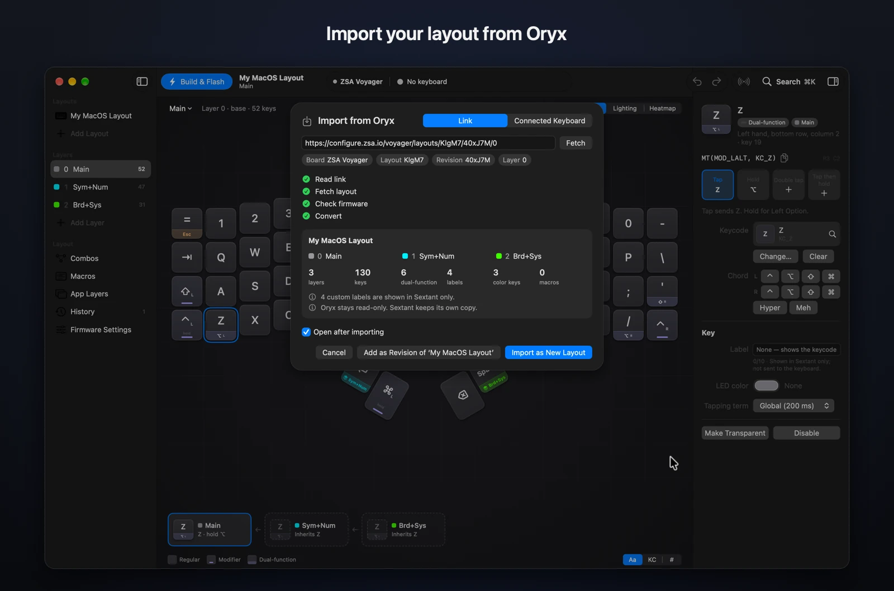
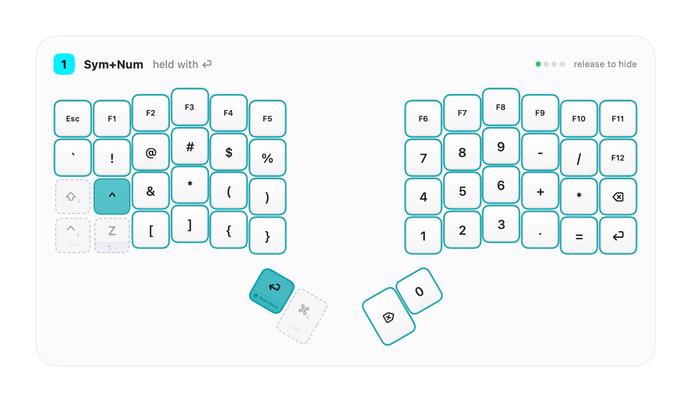
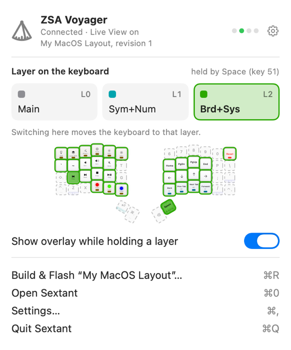

# Sextant

A native macOS app for the ZSA Voyager: edit your layout on your Mac, import it from Oryx, build the firmware locally, flash it, and watch the keyboard live.

[](https://github.com/afrase/Sextant/actions/workflows/ci.yml)
[](https://github.com/afrase/Sextant/releases/latest)
[](LICENSE)




> [!NOTE]
> Sextant is an independent project, not affiliated with or endorsed by ZSA Technology Labs. ZSA, Voyager, Navigator, Oryx and Keymapp are trademarks of their owners, used here only to describe compatibility.

## Features

- **Edit everything locally, with undo:** layers, tap/hold/double-tap actions, chords, labels, per-key colors, tapping terms, macros, combos, firmware settings and the Navigator.
- **Import from Oryx** by pasting a layout link. Read-only: no login, nothing changes in your Oryx account.
- **Build and flash on your Mac,** with a pinned, sandboxed QMK toolchain and a flasher that only writes where it should.
- **See the keyboard live:** the active layer and the keys you press, an overlay of the layer you hold, layer switching from the menu bar or shortcuts, and App Layers that follow the app you're in.
- **Lighting and heatmap:** paint a layer's LEDs and preview them on the keyboard; see which keys you actually use.
- **History and export:** revisions you can compare and restore; export JSON, QMK source, firmware, PNG or PDF.

| Layer overlay, over any app | Menu bar |
|---|---|
|  |  |

[The guide](docs/guide.md) walks through each feature.

## Install

```sh
brew install --cask afrase/tap/sextant
```

Or download the zip from [Releases](https://github.com/afrase/Sextant/releases). Releases are signed ad hoc, not notarized: the Homebrew cask clears the quarantine flag for you, and a zip you download yourself needs System Settings › Privacy & Security › Open Anyway on first launch.

Sextant needs macOS 26 on Apple silicon. Editing works without a keyboard. It has been tested on a Voyager with the STM32 bootloader; images for the GD32 bootloader are refused, and the Navigator trackball is untested.

## Build from source

Needs Xcode 26 (Swift 6.2 or later).

```sh
git clone https://github.com/afrase/Sextant.git
cd Sextant
scripts/bundle            # release build at .build/Sextant.app
open .build/Sextant.app
```

`scripts/check` is the quality gate (formatting, lint, layer rules, a warnings-as-errors build and the tests). See [CONTRIBUTING.md](CONTRIBUTING.md).

## Safety

- **The flasher writes only the application region,** `[0x08002000, 0x08042000)`, and can't mass erase, so the bootloader is never touched.
- **Every image is checked before the first write:** its DFU suffix must match the connected bootloader and its md5 the build. It asks first before replacing a different layout.
- **Generated firmware keeps the Navigator working,** and builds run in a sandbox with no network and no access to your files.
- **Nothing is sent to the keyboard unless you ask:** the live view, layer moves and lighting previews start only when you turn them on.
- **If a flash goes wrong,** the Voyager's reset button puts it back in its bootloader, and you can flash again.

## Privacy

No accounts, analytics or telemetry. Sextant goes online only to import from Oryx and to download the build tools on the first build. The live view sees key positions, never characters, and pauses in password fields. The heatmap is off until you turn it on, keeps only hourly counts per key, and stays on your Mac.

## Documentation

- [docs/guide.md](docs/guide.md): using Sextant.
- [docs/architecture.md](docs/architecture.md): the code design. It's a clean (hexagonal) architecture with one SwiftPM target per layer, so a wrong import fails to compile.
- [docs/decisions.md](docs/decisions.md) and [docs/adr/](docs/adr/): every significant decision and why.
- [docs/design/ui-spec.md](docs/design/ui-spec.md): the UI specification.
- [docs/research/00-overview.md](docs/research/00-overview.md): how Oryx, the firmware, the flasher and the live protocol work.
- [docs/progress.md](docs/progress.md): what's done and what's next. Sextant is built with Claude Code, and this is its working log.

To report a vulnerability, follow [SECURITY.md](SECURITY.md) rather than opening an issue.

## License

[MIT](LICENSE).

<details>
<summary>Third-party software</summary>

- **QMK firmware** (GPL-2.0-or-later) is downloaded at build time, pinned by checksum, and compiled on your Mac. It is not bundled with Sextant. The Arm GNU toolchain, Python and GNU make are downloaded the same way.
- **Swift packages**, pinned to exact versions:

  | Package | License | Used for |
  |---|---|---|
  | [swift-async-algorithms](https://github.com/apple/swift-async-algorithms) | Apache-2.0 | The app |
  | [swift-subprocess](https://github.com/swiftlang/swift-subprocess) | Apache-2.0 | The app |
  | [swift-system](https://github.com/apple/swift-system) | Apache-2.0 | The app (via swift-subprocess) |
  | [swift-collections](https://github.com/apple/swift-collections) | Apache-2.0 | The app (via swift-async-algorithms) |
  | [KeyboardShortcuts](https://github.com/sindresorhus/KeyboardShortcuts) | MIT | The app (global layer shortcuts) |
  | [MenuBarExtraAccess](https://github.com/orchetect/MenuBarExtraAccess) | MIT | The app (closing the menu bar panel) |
  | [swift-argument-parser](https://github.com/apple/swift-argument-parser) | Apache-2.0 | The snapshot tool |
  | [swift-clocks](https://github.com/pointfreeco/swift-clocks) | MIT | Tests |
  | [swift-snapshot-testing](https://github.com/pointfreeco/swift-snapshot-testing) | MIT | Tests |
  | [swift-issue-reporting](https://github.com/pointfreeco/swift-issue-reporting), [swift-concurrency-extras](https://github.com/pointfreeco/swift-concurrency-extras) | MIT | Tests (via swift-clocks) |
  | [swift-custom-dump](https://github.com/pointfreeco/swift-custom-dump) | MIT | Resolved for swift-snapshot-testing, not built |
  | [swift-syntax](https://github.com/swiftlang/swift-syntax) | Apache-2.0 | Resolved for swift-snapshot-testing, not built |
  | [SwiftLintPlugins](https://github.com/SimplyDanny/SwiftLintPlugins) | MIT | Linting |
  | [Periphery](https://github.com/peripheryapp/periphery) | MIT | Unused-code report (`Tools/`) |

- `docs/research/oryx-examples/` holds the author's own Oryx layout and Oryx's generated source for it, used as golden test data. The zip includes a QMK-built firmware binary, which is GPL-2.0-or-later.
- The screenshots are rendered offscreen from the author's own layout and contain no ZSA artwork.

</details>
